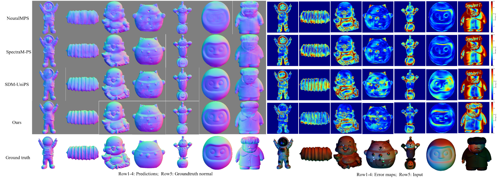
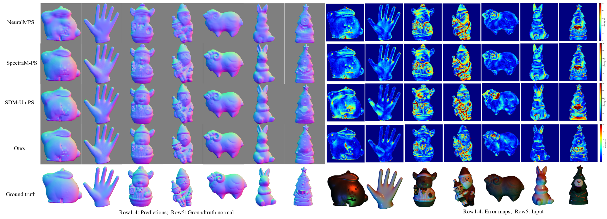
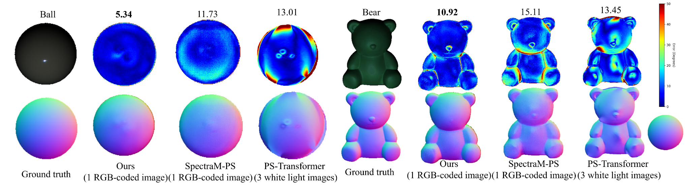
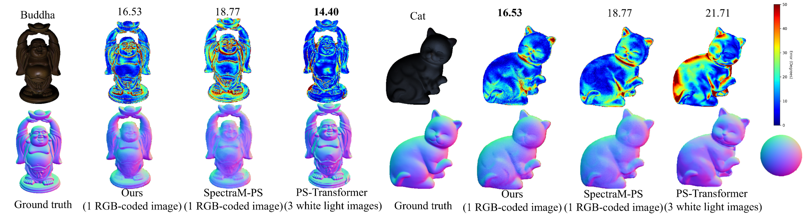
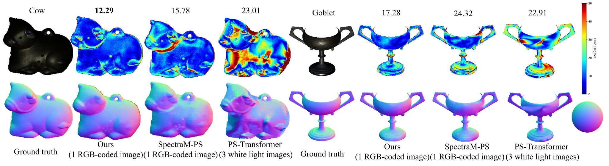
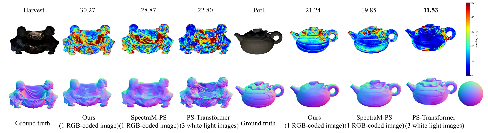
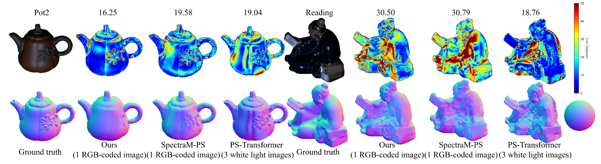
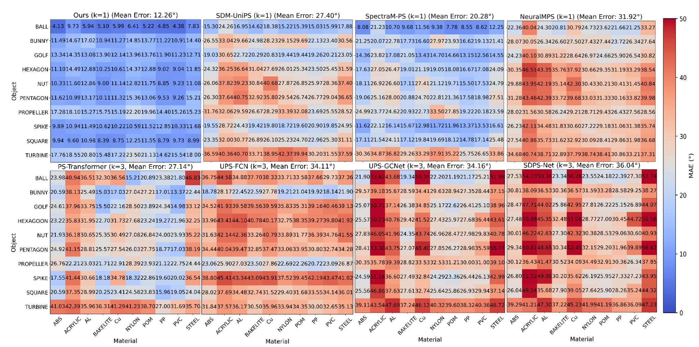

# Experimental Results Summary

> This document summarises the experimental results of RGB-coded photometric stereo, including the main results and ablation experiments for SpectraM14, generalisation experiments for DiLiGenT and DiLiGenT10², multi-shot scalability, computational efficiency and visualisation results. All errors are expressed as mean angular error in degrees; lower values are better.

## 1. Experimental Protocol Overview

- **Primary setting**: single-shot RGB-coded input (`K=1` / `N=1`)，which is the surface normal is estimated following a single RGB-coded acquisition.。
- **Compared RGB-coded / spectral methods**: NeuralMPS, SpectraM-PS, SDM-UniPS, Ours。
- **Compared white-light methods**: UPS-GCN, SDPS-Net, UPS-FCN, PS-Transformer；These methods use three white-light images.
- **Main metric**: Mean Angular Error (MAE, °)，lower is better。

## 2. SpectraM14 Multiplexing: Main Quantitative Results

### Table 1. Object-wise MAE on SpectraM14 Multiplexing

#### Table 1a Object-wise MAE on SpectraM14 Multiplexing (Objects 01–07)
|  | Object01 | Object02 | Object03 | Object04 | Object05 | Object06 | Object07 | Mean |
| --- | --- | --- | --- | --- | --- | --- | --- | --- |
| NeuralMPS | 33.21 | 26.68 | 29.06 | 19.91 | 25.36 | 23.52 | 40.68 | 25.63 |
| SpectraM-PS | 24.29 | 23.21 | 22.68 | **11.56** | 25.81 | **9.06** | 44.86 | 19.52 |
| SDM-UniPS | 24.75 | 25.48 | 25.00 | 15.61 | 23.52 | 15.41 | 45.16 | 21.31 |
| Ours | **16.24** | **18.75** | **20.55** | 11.83 | **18.61** | 9.68 | **31.07** | **15.41** |

#### Table 1b. Object-wise MAE on SpectraM14 Multiplexing (Objects 08–14)
|  | Object08 | Object09 | Object10 | Object11 | Object12 | Object13 | Object14 | Mean |
| --- | --- | --- | --- | --- | --- | --- | --- | --- |
| NeuralMPS | 20.17 | 16.19 | 26.48 | 27.09 | 17.70 | 29.18 | 23.59 | 25.63 |
| SpectraM-PS | 12.02 | 11.30 | 18.41 | 25.94 | **10.10** | 15.38 | 18.71 | 19.52 |
| SDM-UniPS | 14.80 | 10.72 | 19.60 | 25.40 | 13.43 | 16.21 | 23.20 | 21.31 |
| Ours | **9.88** | **8.06** | **14.83** | **19.74** | 10.47 | **11.00** | **15.05** | **15.41** |

### Key observations

- Ours achieves the best average MAE: **15.41°**.

- Compared with NeuralMPS, Ours reduces MAE by **10.22°** (**39.87%**).

- Compared with SpectraM-PS, Ours reduces MAE by **4.11°** (**21.06%**).

- Compared with SDM-UniPS, Ours reduces MAE by **5.89°** (**27.67%**).

- Object-wise, Ours obtains the best result on **11/14** objects and ranks second on **3/14** objects, indicating stable performance across different surface shapes and appearances.

## 3. SpectraM14 Multiplexing: Ablation Study

### Table 2. Ablation study under the single-shot RGB-coded setting

| Variant | Oracle Light | Light Alignment | Per-pixel Branch | Weak KD | Mean MAE ↓ |
| --- | --- | --- | --- | --- | --- |
| Baseline | – | – | – | – | 21.31 |
| Calib-Baseline | ✓ | – | – | – | 15.56 |
| Baseline-align light | – | ✓ | – | – | 20.03 |
| Baseline-align light + PP | – | ✓ | ✓ | – | 19.72 |
| Ours | – | ✓ | ✓ | ✓ | **15.41** |

### Component analysis

- **Baseline** obtains **21.31°**, showing that directly adapting SDM-UniPS to compact RGB-coded observations is insufficient.

- **Calib-Baseline** directly uses correct light directions and reaches **15.56°**, confirming that accurate RGB-channel illumination geometry is highly beneficial.

- **Teacher-assisted light alignment** improves Baseline from **21.31°** to **20.03°**, an absolute reduction of **1.28°**.

- Adding the **per-pixel branch** further improves the result from **20.03°** to **19.72°**, indicating that local photometric detail preservation contributes complementary information.

- The full model reaches **15.41°**, improving over Baseline by **5.89°** and slightly outperforming the oracle Calib-Baseline by **0.15°**. This suggests that weak teacher guidance transfers reconstruction priors beyond light estimation alone.

## 4. DiLiGenT: Generalization to White-light Benchmark

### Table 3. Object-wise MAE on DiLiGenT

#### Table 3a. Object-wise MAE on DiLiGenT (Ball–Cow)
| DiLiGenT | Ball | Bear | Buddha | Cat | Cow | Mean |
| --- | --- | --- | --- | --- | --- | --- |
| NeuralMPS(K=1) | 18.49 | 21.59 | 32.41 | 23.17 | 24.82 | 27.05 |
| SpectraM-PS(K=1) | 11.73 | 15.11 | 28.06 | 18.77 | 15.78 | 21.29 |
| SDM-UniPS(K=1) | 17.51 | 17.36 | 30.19 | 21.84 | 18.04 | 23.91 |
| Ours(K=1) | **5.34** | **10.92** | 23.27 | **16.53** | **12.29** | 18.39 |
| UPS-GCN(K=3) | 23.69 | 23.24 | 34.03 | 23.46 | 28.36 | 30.12 |
| SDPS-Net(K=3) | 23.37 | 19.92 | 24.14 | 21.46 | 26.62 | 27.28 |
| UPS-FCN(K=3) | 15.34 | 26.03 | 31.34 | 21.06 | 15.92 | 26.09 |
| PS-Transformer(K=3) | 13.01 | 13.45 | **14.40** | 21.71 | 23.01 | **18.06** |

#### Table 3b. Object-wise MAE on DiLiGenT (Goblet–Reading)
| DiLiGenT | Goblet | Harvest | Pot1 | Pot2 | Reading | Mean |
| --- | --- | --- | --- | --- | --- | --- |
| NeuralMPS(K=1) | 30.23 | 34.66 | 22.24 | 25.55 | 37.33 | 27.05 |
| SpectraM-PS(K=1) | 24.32 | 28.87 | 19.85 | 19.58 | 30.79 | 21.29 |
| SDM-UniPS(K=1) | 27.01 | 35.38 | 22.31 | 20.17 | 29.29 | 23.91 |
| Ours(K=1) | **17.28** | 30.27 | 21.24 | **16.25** | 30.50 | 18.39 |
| UPS-GCN(K=3) | 35.86 | 37.16 | 30.02 | 30.77 | 34.59 | 30.12 |
| SDPS-Net(K=3) | 33.76 | 35.41 | 23.24 | 26.89 | 37.95 | 27.28 |
| UPS-FCN(K=3) | 32.97 | 35.50 | 22.55 | 27.37 | 32.86 | 26.09 |
| PS-Transformer(K=3) | 22.91 | **22.80** | **11.53** | 19.04 | **18.76** | **18.06** |

### Key observations

- Ours obtains **18.39°** with only **1 RGB-coded image**.

- Compared with NeuralMPS, SpectraM-PS, and SDM-UniPS, Ours reduces MAE by **8.66° / 32.02%**, **2.90° / 13.61%**, and **5.52° / 23.09%**, respectively.

- Compared with conventional white-light baselines using 3 images, Ours outperforms UPS-GCN, SDPS-Net, and UPS-FCN, and is close to PS-Transformer: **18.39° vs. 18.06°**.

- Object-wise, Ours is best on **6/10** DiLiGenT objects. PS-Transformer remains strong on several objects because it uses three white-light images, whereas Ours uses only one RGB-coded image.

## 5. DiLiGenT10²: Generalization under Shape-Material Variation

### Table 4. Mean MAE on DiLiGenT10²

| DiLiGenT10^2 | Mean MAE |
| --- | --- |
| NeuralMPS(K=1) | 31.92 |
| SpectraM-PS(K=1) | 20.28 |
| SDM-UniPS(K=1) | 27.40 |
| Ours(K=1) | **12.26** |
| UPS-GCN(K=3) | 34.16 |
| SDPS-Net(K=3) | 36.04 |
| UPS-FCN(K=3) | 34.11 |
| PS-Transformer(K=3) | 27.14 |

### Key observations

- Ours obtains the lowest mean MAE: **12.26°**.

- Relative to NeuralMPS, SpectraM-PS, SDM-UniPS, and PS-Transformer, Ours reduces MAE by **61.59%**, **39.55%**, **55.26%**, and **54.83%**, respectively.

- The large gain on DiLiGenT10² indicates stronger robustness to controlled shape-material variations and synthetic RGB multiplexing with color crosstalk.

## 6. Scalability to Multi-shot RGB-coded Inputs

### Table 5. Multi-shot performance on DiLiGenT

| DiLiGenT | K=1 | K=2 | K=3 | K=4 | K=5 |
| --- | --- | --- | --- | --- | --- |
| NeuralMPS | 27.05 | 25.77 | 25.69 | 24.63 | 24.43 |
| SpectraM-PS | 21.29 | 19.16 | 18.27 | 17.74 | 17.47 |
| SDM-UniPS | 23.91 | 21.94 | 20.40 | 19.72 | 19.52 |
| Ours | **18.39** | **16.20** | **15.06** | **14.11** | **13.70** |

### Table 6. Multi-shot performance on DiLiGenT10²

| DiLiGenT10^2 | K=1 | K=2 | K=3 | K=4 | K=5 |
| --- | --- | --- | --- | --- | --- |
| NeuralMPS | 31.92 | 28.44 | 26.16 | 24.68 | 23.15 |
| SpectraM-PS | 20.28 | 17.94 | 16.63 | 16.15 | 15.65 |
| SDM-UniPS | 27.40 | 25.05 | 23.80 | 22.87 | 22.42 |
| Ours | **12.26** | **10.32** | **9.38** | **8.92** | **8.61** |

### Key observations

- On DiLiGenT, Ours improves from **18.39°** at K=1 to **13.70°** at K=5, corresponding to an absolute reduction of **4.69°** (**25.50%**).

- On DiLiGenT10², Ours improves from **12.26°** at K=1 to **8.61°** at K=5, corresponding to an absolute reduction of **3.65°** (**29.77%**).

- Compared with SpectraM-PS, Ours maintains a clear advantage: **2.90° / 3.77°** lower on DiLiGenT at K=1/K=5, and **8.02° / 7.04°** lower on DiLiGenT10² at K=1/K=5.

- These results show that the model is not restricted to the single-shot setting and can trade additional RGB-coded observations for higher reconstruction accuracy.

## 7. Computational Efficiency

### Table 7. Efficiency comparison under the single-shot setting

| Method | Params ↓ | FLOPs ↓ | Time ↓ |
| --- | --- | --- | --- |
| NeuralMPS | 6.62 M | 33.36 G | 22.25 ms |
| SpectraM-PS | 61.04 M | 2260.34 G | 846.83 ms |
| SDM-UniPS | 62.75 M | 889.93 G | 665.72 ms |
| Ours | 63.18 M | 866.29 G | 369.58 ms |

### Key observations

- Ours reduces inference time from **665.72 ms** to **369.58 ms** compared with SDM-UniPS, a **44.48%** reduction.

- Compared with SpectraM-PS, Ours is approximately **2.29×** faster and uses substantially fewer FLOPs.

- NeuralMPS remains the fastest, but its reconstruction accuracy is much lower than Ours; therefore, Ours offers a stronger accuracy-efficiency trade-off among RGB-coded/spectral photometric stereo methods.

## 8. Qualitative Results

### 8.1 SpectraM14 qualitative comparisons

**Figure 1.** SpectraM14 qualitative comparison: predicted normal maps and error maps for representative objects. Rows compare NeuralMPS, SpectraM-PS, SDM-UniPS, and Ours, with ground-truth normals and input appearance shown for reference.

**Figure 2.** Additional SpectraM14 qualitative comparison on representative objects. Ours generally preserves clearer local geometry and produces lower-error regions than the compared RGB-coded baselines.

### 8.2 DiLiGenT object-wise qualitative comparisons

**Figure 3.** DiLiGenT qualitative comparison for representative objects. Ours and SpectraM-PS use one RGB-coded image, while PS-Transformer uses three white-light images. The top row shows angular error maps and the bottom row shows predicted or ground-truth normal maps.

**Figure 4.** DiLiGenT qualitative comparison for representative objects. Ours and SpectraM-PS use one RGB-coded image, while PS-Transformer uses three white-light images. The top row shows angular error maps and the bottom row shows predicted or ground-truth normal maps.

**Figure 5.** DiLiGenT qualitative comparison for representative objects. Ours and SpectraM-PS use one RGB-coded image, while PS-Transformer uses three white-light images. The top row shows angular error maps and the bottom row shows predicted or ground-truth normal maps.

**Figure 6.** DiLiGenT qualitative comparison for representative objects. Ours and SpectraM-PS use one RGB-coded image, while PS-Transformer uses three white-light images. The top row shows angular error maps and the bottom row shows predicted or ground-truth normal maps.

**Figure 7.** DiLiGenT qualitative comparison for representative objects. Ours and SpectraM-PS use one RGB-coded image, while PS-Transformer uses three white-light images. The top row shows angular error maps and the bottom row shows predicted or ground-truth normal maps.

### 8.3 DiLiGenT10² shape-material error matrix

**Figure 8.** Shape-material error matrix on DiLiGenT10². Ours shows consistently lower MAE across most object-material combinations, supporting the quantitative results in Table 4.

## 9. Manuscript-ready Summary

Ours consistently improves single-shot RGB-coded photometric stereo across the primary SpectraM14 benchmark and the cross-benchmark DiLiGenT / DiLiGenT10² evaluations. On SpectraM14, the proposed method reaches **15.41°** average MAE and reduces the error by **39.87%**, **21.06%**, and **27.67%** compared with NeuralMPS, SpectraM-PS, and SDM-UniPS, respectively. The ablation study confirms that internal light self-calibration, per-pixel photometric detail preservation, and weak teacher-guided feature/output alignment all contribute to the final performance. On DiLiGenT and DiLiGenT10², the model shows strong generalization despite using only one RGB-coded image, and the multi-shot experiments further demonstrate scalability when more RGB-coded observations are available. Finally, the efficiency comparison indicates that the proposed model achieves a favorable accuracy-efficiency trade-off, reducing inference time substantially relative to SDM-UniPS and SpectraM-PS while maintaining superior reconstruction accuracy.

